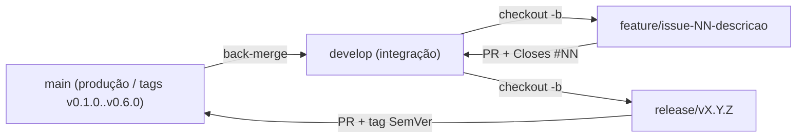

# 🏦 Financeiro Pessoal — API de Controle de Finanças Pessoais

[](https://victoriazambomg.github.io/financeiro-pessoal/)
[](https://github.com/victoriazambomg/financeiro-pessoal/actions/workflows/ci.yml)
[](https://github.com/victoriazambomg/financeiro-pessoal/releases)
[](./LICENSE)
[](https://nodejs.org/)
[-3178C6.svg)](https://www.typescriptlang.org/)
[](#%EF%B8%8F-execu%C3%A7%C3%A3o-dos-testes)

---

> 🌐 **Acesse a Aplicação Interativa, Swagger UI (OpenAPI 3.0) e Documentação no GitHub Pages:**
> **[https://victoriazambomg.github.io/financeiro-pessoal/](https://victoriazambomg.github.io/financeiro-pessoal/)**

---

## 📌 O Problema e a Solução

Controlar para onde vai o dinheiro todos os meses costuma esbarrar em dois extremos: planilhas manuais que exigem manutenção de fórmulas ou aplicativos comerciais complexos que cobram assinaturas e exigem compartilhamento de dados bancários.

O **Financeiro Pessoal** resolve esse problema oferecendo uma **API REST leve, aberta e auto-hospedável** desenvolvida em **Node.js + TypeScript + Express**. Com ela é possível registrar receitas e despesas classificadas por categoria, filtrar movimentações por período e obter instantaneamente o saldo geral e o resumo mensal detalhado por categoria — tudo com persistência local atômica e controle de concorrência em JSON, sem necessidade de configurar servidores de banco de dados.

---

## ✨ Funcionalidades: Implementadas vs. Planejadas

| Funcionalidade | Requisito | Status | Versão |
|---|---|---|---|
| Endpoint de verificação de saúde (`GET /health`) | RNF03 | ✅ Implementada | `v0.1.0` |
| Persistência local em arquivo JSON com escrita atômica e fila mutex (`runExclusive`) | RNF01 | ✅ Implementada | `v0.2.0` / `v0.6.0` |
| Tratamento centralizado de erros e validação de entrada | RF12, RNF04, RNF07 | ✅ Implementada | `v0.2.0` |
| Cadastrar transação — receita ou despesa (`POST /transacoes`) | RF01 | ✅ Implementada | `v0.2.0` |
| Listar transações ordenadas por data (`GET /transacoes`) | RF02 | ✅ Implementada | `v0.2.0` |
| Filtrar transações por `tipo`, `categoria` e `mes` (`AAAA-MM`) | RF03 | ✅ Implementada | `v0.2.0` |
| Consultar transação por ID (`GET /transacoes/:id`) | RF04 | ✅ Implementada | `v0.2.0` |
| Editar transação existente (`PUT /transacoes/:id`) | RF05 | ✅ Implementada | `v0.2.0` |
| Excluir transação (`DELETE /transacoes/:id`) | RF06 | ✅ Implementada | `v0.2.0` |
| Listar categorias e semear 8 categorias padrão (`GET /categorias`) | RF07 | ✅ Implementada | `v0.3.0` |
| Cadastrar categoria personalizada sem duplicidade (`POST /categorias`) | RF08 | ✅ Implementada | `v0.3.0` |
| Excluir categoria com bloqueio se estiver em uso (`DELETE /categorias/:id`) | RF09 | ✅ Implementada | `v0.3.0` |
| Consultar saldo geral (`GET /resumo`) | RF10 | ✅ Implementada | `v0.3.0` |
| Consultar resumo mensal com totais por categoria (`GET /resumo?mes=AAAA-MM`) | RF11, RNF08 | ✅ Implementada | `v0.3.0` |
| Suíte de testes automatizados com meta `>= 80%` no Jest e badge gerado do `lcov` | RNF05 | ✅ Implementada | `v0.3.0` / `v0.6.0` |
| Benchmark automatizado de desempenho (`10.000` transações `< 200 ms`) | RNF02 | ✅ Implementada | `v0.6.0` |
| Pipeline de CI no GitHub Actions (Node 20/22, cobertura `lcov`, performance, auditoria) | RNF09 | ✅ Implementada | `v0.4.0` / `v0.6.0` |
| Portal Interativo + Swagger UI (`openapi.yaml`) no GitHub Pages | RNF04, RNF09 | ✅ Implementada | `v0.5.0` / `v0.6.0` |
| Autenticação JWT e múltiplos usuários | RF13 | 🗓️ Planejada (Backlog futuro) | `v1.0.0` |
| Transações recorrentes e metas de orçamento por categoria | RF14 | 🗓️ Planejada (Backlog futuro) | `v1.1.0` |
| Importação e exportação de extratos (CSV / OFX) | RF15 | 🗓️ Planejada (Backlog futuro) | `v1.2.0` |

---

## 📚 Documentação de Engenharia (`docs/`)

Toda a especificação e modelagem do projeto está documentada na pasta [`docs/`](./docs):

| Documento | Descrição |
|---|---|
| 🗂️ [**Índice da Documentação (`docs/README.md`)**](./docs/README.md) | Catálogo com versão, data de atualização e regra de sincronização `documentação ↔ código`. |
| 📜 [**Project Charter (Termo de Abertura)**](./docs/project-charter.md) | Justificativa, visão do produto, objetivos SMART, escopo (dentro/fora), stakeholders, público-alvo, riscos e milestones. |
| 📋 [**Requisitos Funcionais e Não Funcionais**](./docs/requisitos.md) | Lista rastreável de RFs (`[RF01]`–`[RF15]`), RNFs (`[RNF01]`–`[RNF09]`), Regras de Negócio (`RN01`–`RN04`) e matriz resumida. |
| 🔗 [**Matriz de Rastreabilidade Bidirecional (N3)**](./docs/rastreabilidade.md) | Mapeamento completo `RF/RNF → Caso de Uso → User Story → Issue → Código (src/) → Arquivo de Teste (tests/)`. |
| 🎭 [**Especificação de Casos de Uso**](./docs/casos-de-uso.md) | Descrição dos atores, diagrama de casos de uso e fluxos principal, alternativos e de exceção (`UC01` a `UC06`). |
| 📖 [**Histórias de Usuário (User Stories)**](./docs/user-stories.md) | Histórias `US01` a `US09` no padrão canônico com critérios de aceite em BDD/Gherkin (*Dado / Quando / Então*) e estimativa em Story Points. |
| 🏗️ [**Arquitetura e Modelagem**](./docs/arquitetura.md) | Diagramas C4 (Contexto, Contêineres e Componentes), Diagrama de Classes, Modelo Entidade-Relacionamento (DER), Diagrama de Sequência e ADRs. |
| 📜 [**Especificação OpenAPI 3.0 (`openapi.yaml`)**](./docs/openapi.yaml) | Contrato formal das 9 rotas REST com esquemas e exemplos de erro `400`, `404`, `409` e `413` (renderizado no Swagger UI do portal). |
| 🤝 [**Guia de Contribuição (`CONTRIBUTING.md`)**](./CONTRIBUTING.md) | Fluxo Git Flow, padrão Conventional Commits, execução de testes e checklist de Pull Request. |
| 📦 [**Changelog**](./CHANGELOG.md) | Histórico de versões seguindo SemVer (`v0.1.0` a `v0.6.0`). |

---

## 🛠️ Tecnologias Utilizadas

- **Runtime:** [Node.js](https://nodejs.org/) (v20+)
- **Linguagem:** [TypeScript 5](https://www.typescriptlang.org/) (`strict: true`)
- **Framework HTTP:** [Express 5](https://expressjs.com/)
- **Persistência:** Arquivo JSON local (`data/db.json`) com escrita atômica, fila de exclusão mútua (`runExclusive`) e interface `Repository<T>` pronta para SQLite
- **Testes:** [Jest 29](https://jestjs.io/) + `ts-jest` + [Supertest](https://github.com/ladjs/supertest)
- **CI/CD & DevSecOps:** [GitHub Actions](./.github/workflows/ci.yml) + Dependabot + GitHub Pages

---

## 🚀 Configuração, Instalação e Execução Local

### Pré-requisitos

- [Node.js](https://nodejs.org/) **20.x** ou superior
- [Git](https://git-scm.com/)

### Passo a passo

```bash
# 1. Clone o repositório
git clone https://github.com/victoriazambomg/financeiro-pessoal.git
cd financeiro-pessoal

# 2. Copie o arquivo de variáveis de ambiente de exemplo
cp .env.example .env

# 3. Instale as dependências
npm install

# 4. Inicie em modo de desenvolvimento (com hot-reload)
npm run dev
```

A API estará disponível em `http://localhost:3000`.

### Variáveis de ambiente (`.env.example`)

| Variável | Padrão | Descrição |
|---|---|---|
| `PORT` | `3000` | Porta HTTP em que o servidor escuta |
| `DATA_FILE` | `data/db.json` | Caminho do arquivo JSON de persistência |
| `NODE_ENV` | `development` | Ambiente de execução (`development`, `test`, `production`) |

---

## 🧪 Execução dos Testes e Cobertura (`RNF05` & `RNF02`)

O [`jest.config.js`](./jest.config.js) impõe um limite mínimo obrigatório (`coverageThreshold`) de **80%** global em `branches`, `functions`, `lines` e `statements` (atendendo ao requisito **RNF05**). O badge [`docs/coverage-badge.svg`](./docs/coverage-badge.svg) é gerado automaticamente a partir do relatório real (`coverage/coverage-summary.json` / `lcov.info`) pelo script [`scripts/generate-coverage-badge.js`](./scripts/generate-coverage-badge.js), refletindo a cobertura medida no código (**100% de linhas**).

```bash
# Executar todas as suítes de testes (unitários, integração e desempenho RNF02)
npm test

# Executar testes com relatório lcov/json-summary e validar cobertura >= 80%
npm run test:coverage

# Atualizar o badge SVG a partir do relatório real gerado pelo Jest
node scripts/generate-coverage-badge.js

# Executar apenas o benchmark de desempenho RNF02 (10.000 transações < 200 ms)
npx jest tests/performance/rnf02-desempenho.test.ts --verbose
```

---

## 🌿 Fluxo de Branches (Git Flow) e Padrões de Versionamento

O desenvolvimento segue o **Git Flow**, com commits atômicos no padrão **Conventional Commits** e **Versionamento Semântico (SemVer)**:



| Branch | Propósito | Origem | Destino (Merge) |
|---|---|---|---|
| `main` | Código estável de produção; cada merge gera uma tag anotada SemVer (`v0.1.0` a `v0.6.0`) | — | — |
| `develop` | Branch principal de integração das funcionalidades da sprint | `main` | `release/*` |
| `feature/*`, `fix/*`, `docs/*`, `test/*`, `chore/*` | Desenvolvimento isolado de cada Issue do backlog | `develop` | `develop` (via Pull Request com `Closes #NN`) |
| `release/vX.Y.Z` | Preparação de versão estável e fechamento de milestone | `develop` | `main` (via Pull Request) e de volta para `develop` |

---

## 📄 Licença

Distribuído sob a licença **MIT**. Veja [`LICENSE`](./LICENSE) para mais detalhes.
