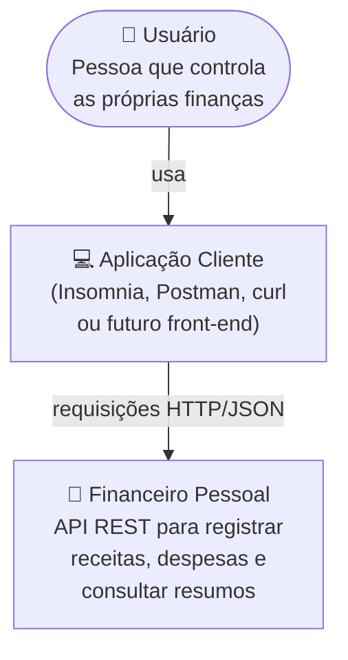
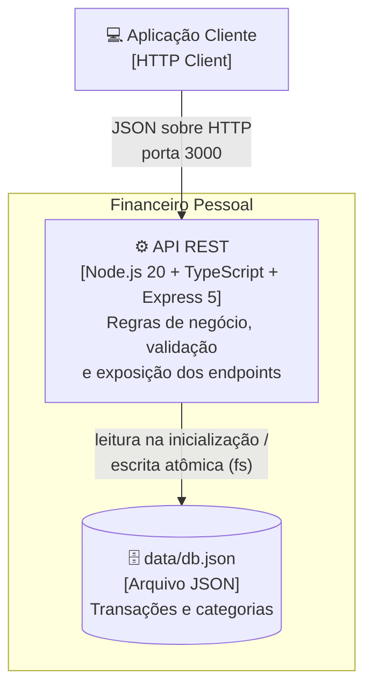
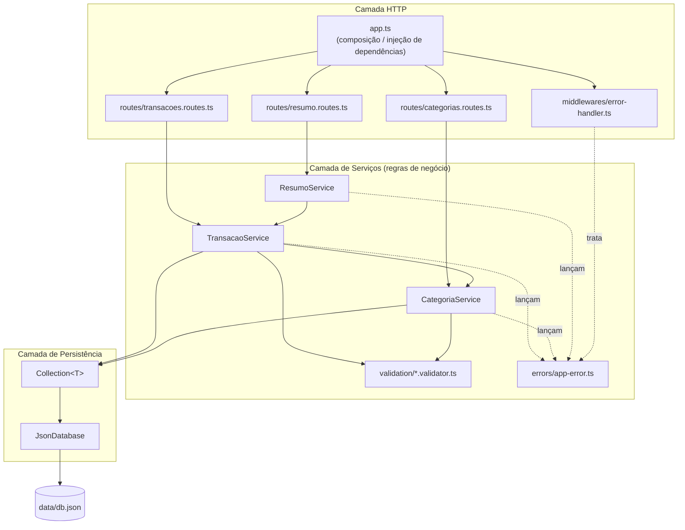
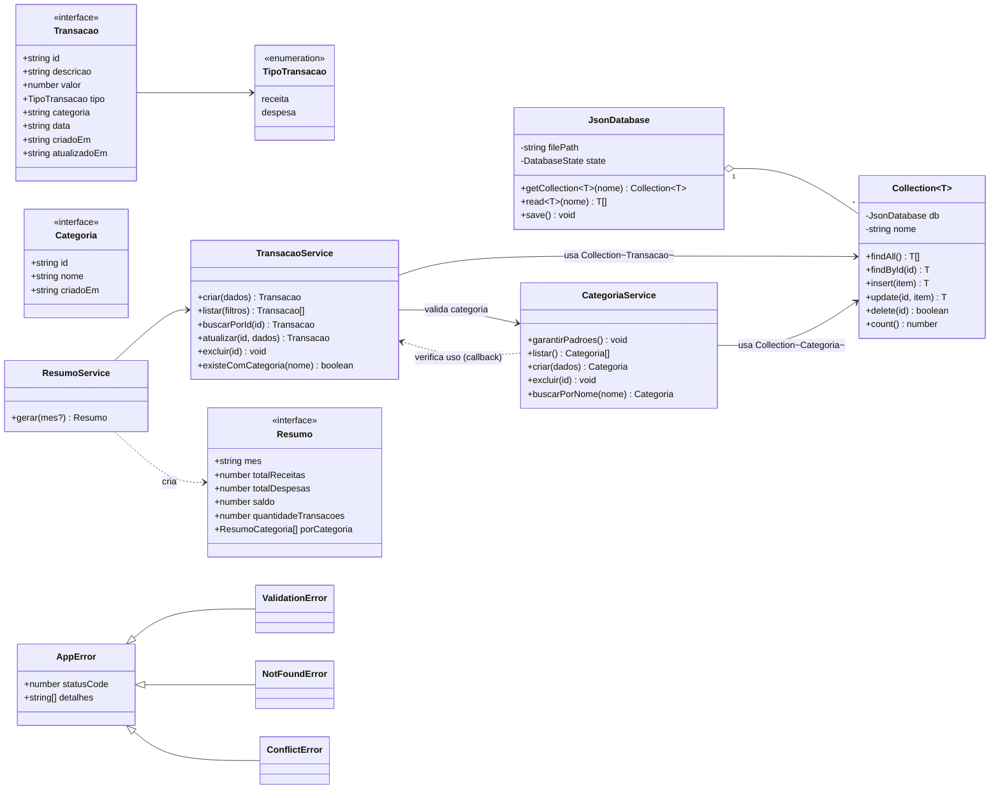
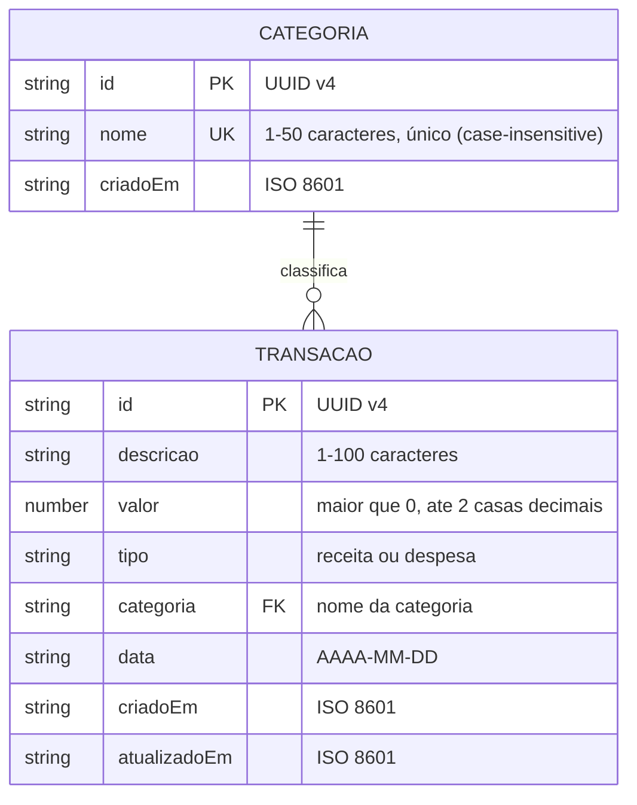
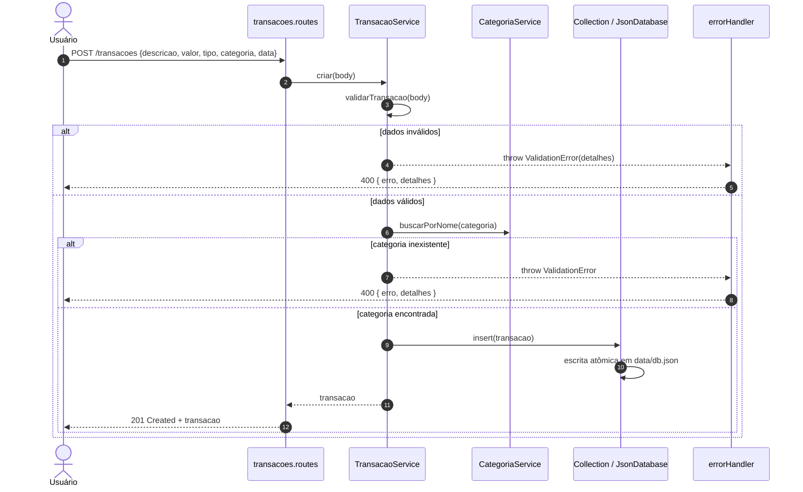

# 🏗️ Arquitetura e Modelagem

Este documento reúne os diagramas de engenharia do Financeiro Pessoal: **C4 Model** (contexto, contêineres e componentes), **diagrama de classes**, **modelo entidade-relacionamento (DER)**, **diagrama de sequência** e a **especificação dos endpoints** da API.

> Todos os diagramas são escritos em [Mermaid](https://mermaid.js.org/) e renderizados automaticamente pelo GitHub.

---

## 1. C4 — Nível 1: Diagrama de Contexto



## 2. C4 — Nível 2: Diagrama de Contêineres



## 3. C4 — Nível 3: Componentes (Arquitetura em Camadas)



**Responsabilidades**

| Camada | Responsabilidade | Não deve |
|---|---|---|
| Rotas (HTTP) | Traduzir requisição/resposta HTTP, extrair parâmetros e status codes | Conter regra de negócio |
| Serviços | Validar entradas, aplicar regras de negócio (RN01–RN04), orquestrar persistência | Conhecer `req`/`res` do Express |
| Persistência | Ler e gravar coleções no arquivo JSON de forma atômica | Conhecer regras de negócio |
| Middleware de erros | Converter exceções em respostas JSON padronizadas | Expor *stack trace* |

## 4. Diagrama de Classes



## 5. Modelo Entidade-Relacionamento (DER)

Embora a persistência seja em arquivo JSON, o modelo de dados é conceitualmente relacional. O relacionamento entre transação e categoria é feito pelo **nome canônico** da categoria (chave natural única).



**Exemplo do arquivo `data/db.json`:**

```json
{
  "categorias": [
    { "id": "6f1c...", "nome": "Alimentação", "criadoEm": "2026-11-05T19:00:00.000Z" }
  ],
  "transacoes": [
    {
      "id": "b7e2...",
      "descricao": "Mercado",
      "valor": 150.75,
      "tipo": "despesa",
      "categoria": "Alimentação",
      "data": "2026-11-05",
      "criadoEm": "2026-11-05T19:10:00.000Z",
      "atualizadoEm": "2026-11-05T19:10:00.000Z"
    }
  ]
}
```

## 6. Diagrama de Sequência — Registrar Transação (UC01)



## 7. Endpoints da API

| Método | Rota | Descrição | Sucesso | Erros | Requisito |
|---|---|---|---|---|---|
| `GET` | `/health` | Verifica se a API está no ar | 200 | — | RNF03 |
| `POST` | `/transacoes` | Cadastra transação | 201 | 400, 413 | RF01, RF12 |
| `GET` | `/transacoes?tipo=&categoria=&mes=` | Lista/filtra transações | 200 | 400 | RF02, RF03 |
| `GET` | `/transacoes/:id` | Consulta transação | 200 | 404 | RF04 |
| `PUT` | `/transacoes/:id` | Edita transação | 200 | 400, 404 | RF05, RF12 |
| `DELETE` | `/transacoes/:id` | Exclui transação | 204 | 404 | RF06 |
| `GET` | `/categorias` | Lista categorias | 200 | — | RF07 |
| `POST` | `/categorias` | Cadastra categoria | 201 | 400, 409 | RF08 |
| `DELETE` | `/categorias/:id` | Exclui categoria sem uso | 204 | 404, 409 | RF09 |
| `GET` | `/resumo?mes=` | Saldo geral ou resumo mensal | 200 | 400 | RF10, RF11 |

**Formato padrão de erro (RNF04):**

```json
{
  "erro": "Dados inválidos.",
  "detalhes": ["valor deve ser um número maior que zero.", "data deve ser uma data válida no formato AAAA-MM-DD."]
}
```

## 8. Decisões de Arquitetura (ADR resumido)

| # | Decisão | Motivação | Consequência |
|---|---|---|---|
| ADR01 | TypeScript em modo `strict` | Segurança de tipos e manutenibilidade (RNF06) | Etapa de build (`tsc`) |
| ADR02 | Express 5 | Maduro, simples e com tratamento nativo de erros em handlers assíncronos | — |
| ADR03 | Persistência em arquivo JSON | Zero infraestrutura, portabilidade (RNF01, RNF03) | Não indicado para alto volume ou concorrência; migração futura para SQLite/PostgreSQL facilitada pela camada `Collection` |
| ADR04 | `createApp()` separado de `server.ts` com injeção do banco | Testes de integração rápidos com Supertest e banco em memória | — |
| ADR05 | Valores monetários calculados em centavos | Precisão (RNF08) | Conversão na entrada/saída dos cálculos |
| ADR06 | Categoria referenciada por nome canônico | Legibilidade do JSON e dos filtros | Renomear categoria exigiria atualizar transações (fora do escopo) |
