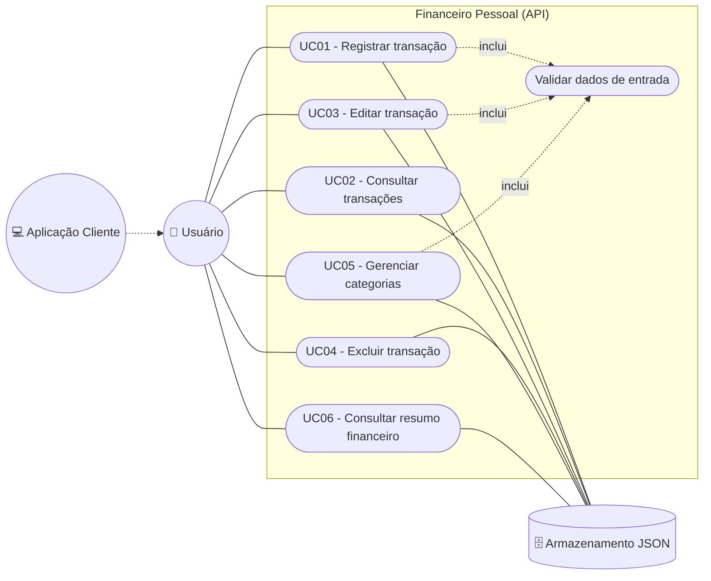

# 🎭 Especificação de Casos de Uso

## 1. Atores

| Ator | Tipo | Descrição |
|---|---|---|
| **Usuário** | Primário (humano) | Pessoa que deseja controlar as próprias finanças. Interage com a API diretamente (via cliente HTTP como Insomnia, Postman, `curl`) ou por meio de uma interface que consome a API. |
| **Aplicação Cliente** | Primário (sistema) | Front-end web, mobile ou CLI que consome a API em nome do Usuário. Possui os mesmos casos de uso do Usuário. |
| **Armazenamento (arquivo JSON)** | Secundário (sistema) | Sistema de arquivos local onde os dados são persistidos (`data/db.json`). É acionado pela API em todas as operações de leitura e escrita. |

## 2. Diagrama de Casos de Uso

## 3. Resumo dos Casos de Uso

| ID | Caso de Uso | Ator principal | Requisitos |
|---|---|---|---|
| UC01 | Registrar transação | Usuário | RF01, RF12 |
| UC02 | Consultar transações | Usuário | RF02, RF03, RF04 |
| UC03 | Editar transação | Usuário | RF05, RF12 |
| UC04 | Excluir transação | Usuário | RF06 |
| UC05 | Gerenciar categorias | Usuário | RF07, RF08, RF09 |
| UC06 | Consultar resumo financeiro | Usuário | RF10, RF11 |

---

## UC01 — Registrar transação

| Campo | Descrição |
|---|---|
| **Ator principal** | Usuário |
| **Atores secundários** | Armazenamento JSON |
| **Objetivo** | Registrar uma receita ou despesa. |
| **Requisitos** | RF01, RF12 |
| **Pré-condições** | A API está em execução. A categoria desejada está cadastrada. |
| **Pós-condições (sucesso)** | A transação é persistida com `id`, `criadoEm` e `atualizadoEm`, e passa a compor listagens e resumos. |

**Fluxo principal**

1. O Usuário envia `POST /transacoes` com `descricao`, `valor`, `tipo`, `categoria` e `data`.
2. O sistema valida os dados de entrada (inclui *Validar dados de entrada*).
3. O sistema verifica se a categoria informada está cadastrada.
4. O sistema gera um identificador único (UUID) e as datas de criação/atualização.
5. O sistema persiste a transação no Armazenamento.
6. O sistema retorna `201 Created` com a transação criada.

**Fluxos alternativos**

- **FA01 — Descrição com espaços extras:** no passo 2, o sistema remove os espaços das extremidades de `descricao` e `categoria` e continua o fluxo.
- **FA02 — Categoria com capitalização diferente:** no passo 3, se o Usuário informar `"alimentação"` e existir `"Alimentação"`, o sistema aceita e grava o nome canônico da categoria.

**Fluxos de exceção**

- **FE01 — Dados inválidos:** no passo 2, se algum campo estiver ausente ou inválido (ex.: valor ≤ 0, mais de 2 casas decimais, tipo diferente de `receita`/`despesa`, data inexistente como `2026-02-30`), o sistema retorna `400 Bad Request` com `erro` e a lista `detalhes` de todos os problemas. Nada é persistido.
- **FE02 — Categoria inexistente:** no passo 3, o sistema retorna `400 Bad Request` informando que a categoria não está cadastrada.
- **FE03 — JSON malformado:** no passo 1, se o corpo não for um JSON válido, o sistema retorna `400 Bad Request`.
- **FE04 — Corpo muito grande:** no passo 1, se o corpo exceder 100 kb, o sistema retorna `413 Payload Too Large`.

---

## UC02 — Consultar transações

| Campo | Descrição |
|---|---|
| **Ator principal** | Usuário |
| **Objetivo** | Visualizar transações registradas, com ou sem filtros, ou uma transação específica. |
| **Requisitos** | RF02, RF03, RF04 |
| **Pré-condições** | A API está em execução. |
| **Pós-condições** | Nenhuma alteração de estado. |

**Fluxo principal (listar)**

1. O Usuário envia `GET /transacoes`.
2. O sistema obtém as transações do Armazenamento.
3. O sistema ordena as transações por `data` (mais recente primeiro).
4. O sistema retorna `200 OK` com a lista.

**Fluxos alternativos**

- **FA01 — Filtrar:** no passo 1, o Usuário informa um ou mais filtros de query (`tipo`, `categoria`, `mes`). No passo 2, o sistema retorna somente as transações que atendem a **todos** os filtros.
- **FA02 — Nenhuma transação:** no passo 4, o sistema retorna `200 OK` com lista vazia `[]`.
- **FA03 — Consultar por id:** o Usuário envia `GET /transacoes/{id}`; o sistema retorna `200 OK` com a transação.

**Fluxos de exceção**

- **FE01 — Filtro inválido:** se `tipo` não for `receita`/`despesa` ou `mes` não estiver no formato `AAAA-MM`, o sistema retorna `400 Bad Request`.
- **FE02 — Transação não encontrada:** no FA03, se o `id` não existir, o sistema retorna `404 Not Found`.

---

## UC03 — Editar transação

| Campo | Descrição |
|---|---|
| **Ator principal** | Usuário |
| **Objetivo** | Corrigir os dados de uma transação já registrada. |
| **Requisitos** | RF05, RF12 |
| **Pré-condições** | A transação existe. |
| **Pós-condições (sucesso)** | A transação é atualizada e `atualizadoEm` recebe a data/hora atual; `id` e `criadoEm` são preservados. |

**Fluxo principal**

1. O Usuário envia `PUT /transacoes/{id}` com todos os campos da transação.
2. O sistema verifica se a transação existe.
3. O sistema valida os dados de entrada (inclui *Validar dados de entrada*) e a categoria.
4. O sistema substitui os dados, preservando `id` e `criadoEm`, e atualiza `atualizadoEm`.
5. O sistema persiste a alteração e retorna `200 OK` com a transação atualizada.

**Fluxos de exceção**

- **FE01 — Transação não encontrada:** no passo 2, retorna `404 Not Found`.
- **FE02 — Dados inválidos:** no passo 3, retorna `400 Bad Request` com `detalhes`; a transação permanece inalterada.

---

## UC04 — Excluir transação

| Campo | Descrição |
|---|---|
| **Ator principal** | Usuário |
| **Objetivo** | Remover uma transação registrada por engano. |
| **Requisitos** | RF06 |
| **Pré-condições** | A transação existe. |
| **Pós-condições (sucesso)** | A transação deixa de existir no Armazenamento e nos resumos. |

**Fluxo principal**

1. O Usuário envia `DELETE /transacoes/{id}`.
2. O sistema verifica se a transação existe.
3. O sistema remove a transação e persiste a alteração.
4. O sistema retorna `204 No Content`.

**Fluxos de exceção**

- **FE01 — Transação não encontrada:** no passo 2, retorna `404 Not Found`.

---

## UC05 — Gerenciar categorias

| Campo | Descrição |
|---|---|
| **Ator principal** | Usuário |
| **Objetivo** | Listar, criar e excluir categorias para organizar as transações. |
| **Requisitos** | RF07, RF08, RF09 |
| **Pré-condições** | A API está em execução. |
| **Pós-condições (sucesso)** | O conjunto de categorias reflete a operação realizada. |

**Fluxo principal (criar categoria)**

1. O Usuário envia `POST /categorias` com `nome`.
2. O sistema valida o nome (obrigatório, 1–50 caracteres).
3. O sistema verifica se já existe categoria com o mesmo nome (sem diferenciar maiúsculas/minúsculas).
4. O sistema persiste a categoria e retorna `201 Created`.

**Fluxos alternativos**

- **FA01 — Listar categorias:** o Usuário envia `GET /categorias`; o sistema retorna `200 OK` com as categorias em ordem alfabética. Na primeira execução, as categorias padrão já estão disponíveis.
- **FA02 — Excluir categoria:** o Usuário envia `DELETE /categorias/{id}`; o sistema verifica que ela não está em uso, remove e retorna `204 No Content`.

**Fluxos de exceção**

- **FE01 — Nome inválido:** no passo 2, retorna `400 Bad Request`.
- **FE02 — Nome duplicado:** no passo 3, retorna `409 Conflict`.
- **FE03 — Categoria em uso:** no FA02, se houver transações com a categoria, retorna `409 Conflict` e nada é removido.
- **FE04 — Categoria não encontrada:** no FA02, se o `id` não existir, retorna `404 Not Found`.

---

## UC06 — Consultar resumo financeiro

| Campo | Descrição |
|---|---|
| **Ator principal** | Usuário |
| **Objetivo** | Saber quanto entrou, quanto saiu e qual o saldo, no geral ou em um mês específico. |
| **Requisitos** | RF10, RF11, RNF08 |
| **Pré-condições** | A API está em execução. |
| **Pós-condições** | Nenhuma alteração de estado. |

**Fluxo principal (saldo geral)**

1. O Usuário envia `GET /resumo`.
2. O sistema obtém todas as transações.
3. O sistema soma receitas e despesas **em centavos inteiros** e calcula o saldo.
4. O sistema agrupa os totais por categoria e tipo.
5. O sistema retorna `200 OK` com `totalReceitas`, `totalDespesas`, `saldo`, `quantidadeTransacoes` e `porCategoria`.

**Fluxos alternativos**

- **FA01 — Resumo mensal:** no passo 1, o Usuário informa `?mes=AAAA-MM`; no passo 2, o sistema considera apenas as transações daquele mês e inclui o campo `mes` na resposta.
- **FA02 — Sem transações no período:** o sistema retorna todos os totais zerados e `porCategoria` vazio.

**Fluxos de exceção**

- **FE01 — Mês inválido:** se `mes` não estiver no formato `AAAA-MM` (mês de 01 a 12), retorna `400 Bad Request`.
